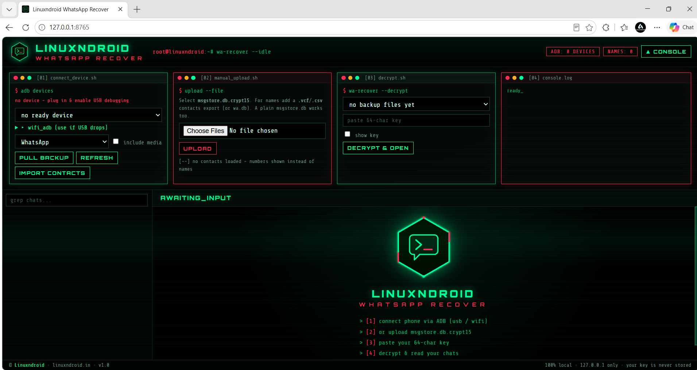

# Linuxndroid WhatsApp Recover

Pull your WhatsApp backup from your Android phone, decrypt it **locally** with **your own 64-digit key**, and browse your chats in the browser.

🔒 100% offline. Runs on `127.0.0.1` only. Nothing is uploaded, and your key is never stored.

## Features

- Pull backups over ADB (USB or Wi-Fi), or upload files manually
- Decrypt `crypt14` / `crypt15` with your 64-character key
- Browse chats, groups, photos, videos, voice messages and documents
- Contact names via `wa.db`, phone import, or `.vcf` / `.csv` upload
- Supports WhatsApp and WhatsApp Business

## Download & Run

1. Download the latest `.exe` from the **[Releases](../../releases)** page.
2. Put `adb.exe` (with `AdbWinApi.dll` and `AdbWinUsbApi.dll`) in the **same folder** as the exe.
   Get them from [Android platform-tools](https://developer.android.com/tools/releases/platform-tools).
3. Double-click the exe. Your browser opens at `http://127.0.0.1:8765`.

> Windows SmartScreen or antivirus may warn about an unsigned app. Click **More info → Run anyway**.

## Get your 64-digit key

Do this **before** the backup you want to recover:

1. WhatsApp → **Settings → Chats → Chat backup → End-to-end encrypted backup**
2. Tap **Turn on** → choose **"Use 64-digit encryption key instead"**
3. **Save the key** and run **Back up** once

⚠️ Without this key, the backup cannot be decrypted by anyone.

## How to use

1. **Connect phone**: enable *USB debugging* and plug in, or use *Wireless debugging* (pair, then connect).
2. **Pull**: choose WhatsApp or WhatsApp Business, optionally include media, press **Pull**.
   (No ADB? Upload `msgstore.db.crypt15` manually.)
3. **Decrypt**: select the full `msgstore.db.crypt15`, paste your key, press **Decrypt**.
4. **Browse** your chats.

## Troubleshooting

| Problem | Fix |
|---|---|
| `adb not found` | Put `adb.exe` and its DLLs next to the exe |
| Device `unauthorized` | Unlock phone, accept the USB debugging prompt |
| `Decryption failed` | Wrong key or incomplete backup file |
| "No messages" after decrypt | You picked an `increment` file. Use the full `msgstore.db.crypt15` |
| Names show as numbers | Import contacts or upload a `.vcf` / `.csv` |

Data is saved in a `wa_data` folder next to the exe. Delete it when you're done.

## Credits & Inspiration
 
This project is inspired by, and its decryption is powered by, **[wa-crypt-tools](https://github.com/ElDavoo/wa-crypt-tools)** by [ElDavoo](https://github.com/ElDavoo). Huge thanks to the author and contributors for their work on WhatsApp backup decryption.

## Disclaimer

For recovering **your own** WhatsApp data only. Not affiliated with WhatsApp or Meta.

---
Made by **Linuxndroid** · [linuxndroid.in](https://linuxndroid.in) · © All rights reserved
